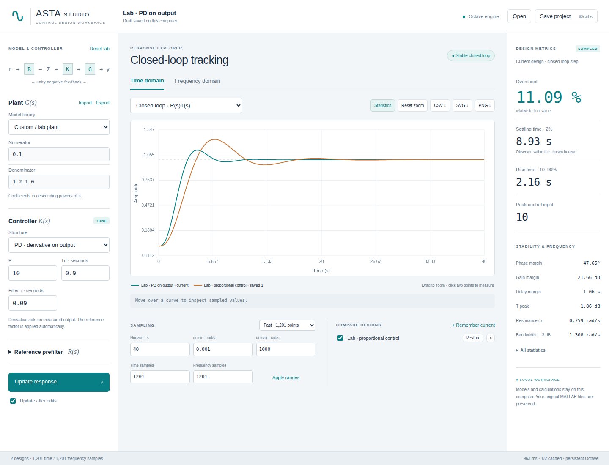
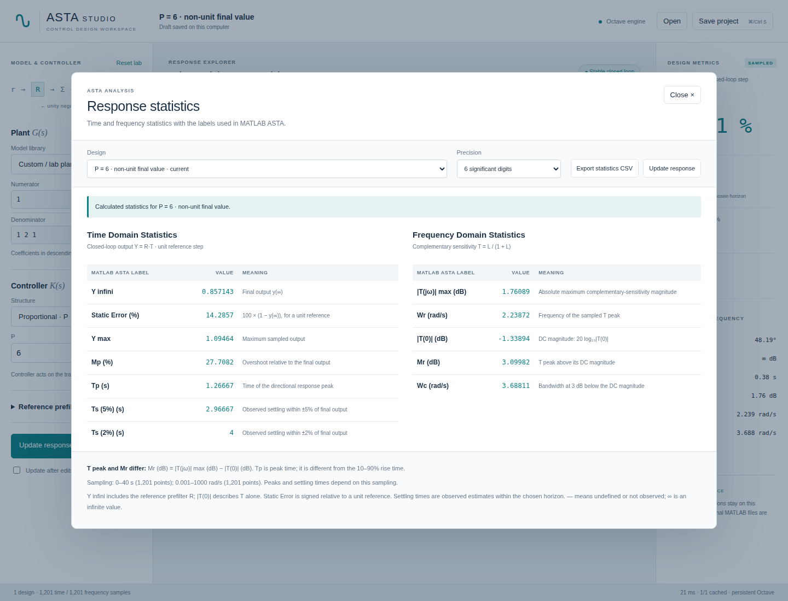

# ASTA Studio

A local control-design workspace for GNU Octave. Edit SISO plants and controllers,
compare designs, and inspect time/frequency responses in a browser. Octave performs
the calculations in a persistent worker; the interface works without Qt graphics.



## Install as an Octave package

Download the package from [Releases](https://github.com/Surriya1010/asta-studio/releases).
In Octave:

```octave
pkg install -forge control  % only if control is not already installed
pkg install "https://github.com/Surriya1010/asta-studio/releases/download/v1.1.0/astastudio-1.1.0.tar.gz"
pkg load astastudio
astastudio
```

The package declares Octave >= 8.4 and control >= 4.0. It was tested with Octave
11.1.0 and control 4.2.1. The browser workspace also needs Python >= 3.8 and
`octave-cli` on PATH. The automatic Octave launcher supports Linux/macOS; on
Windows launch the installed `studio/server.py` from Python as described below.
Loading the package alone does not start a browser or server. After upgrading,
stop an existing Studio server before reopening, or use an unused port such as
`astastudio('open', 'port', 8770)`. The launcher reuses servers already running
on the requested port.

```octave
astastudio('info')     % installed paths and model library
astastudio('version')  % package version
astastudio('test')     % complete numerical and data round-trip self-tests
astastudio('open', 'port', 8770, 'browser', false)
pkg unload astastudio
pkg uninstall astastudio
```

A native package archive follows the [Octave package format](https://docs.octave.org/latest/Creating-Packages.html).
This release is installed from its URL; it has not been submitted to the central
Octave Packages index. Package/unload/uninstall tests use an isolated registry and
leave existing user packages unchanged. `COPYING` records the current unspecified
license status; packaging does not add a software license.

To rebuild and test the installable archive from this checkout:

```sh
python3 tools/build_octave_package.py
python3 tools/test_octave_package.py dist/astastudio-1.1.0.tar.gz
```

The builder creates a reproducible archive with package metadata, runtime assets,
private self-tests, and SHA-256 checksums. No original protected MATLAB code or
course PDFs are included.

## Run

Requires Python 3, GNU Octave (`octave-cli`) and the Octave `control` package.
Tested with Octave 11.1.0 and control 4.2.1. No JavaScript dependencies or external
services are required.

From the repository folder, run:

```sh
python3 asta_octave/studio/server.py
```

Or, in Octave from the repository folder:

```octave
start_asta_octave
```

Open the printed local address, normally http://127.0.0.1:8765. The terminal server
stops with Ctrl+C. The Octave launcher starts it in the background. Use `--port 8770`
for a different port, or `--no-browser` to avoid automatically opening a tab.

## Features

- Inline plant and controller editing; P, I, PI, PD and PID presets.
- Filtered derivative on output and optional reference prefilter.
- Open/closed-loop, control and reference step responses.
- Nichols, Nyquist, Bode, sensitivity and complementary-sensitivity plots.
- Visible response metrics and stability margins.
- MATLAB-labelled time/frequency statistics, selectable design and precision, and statistics CSV export.
- Comparison snapshots, drag zoom, point inspection and measurements.
- CSV/SVG/PNG export, JSON workspace save/load, and original NS/DS model import/export.
- Persistent Octave engine, bounded caches, and view switching without recalculation.
- Responsive desktop/mobile layout and 19 supplied example plant models.

Numerical coefficients and sampled exports retain double precision. Displayed
statistics are sampled estimates; choose a finer grid for more precise values.
A measured 4,001-point request took 671 ms initially and 65–82 ms from cache on the
development machine, with identical numerical results. This is a cache comparison,
not a MATLAB performance benchmark.

## MATLAB-style statistics

Click **Statistics** above the plot. The report shows the MATLAB ASTA labels:

| Time Domain Statistics | Frequency Domain Statistics |
|---|---|
| Y infini | \|T(jω)\| max (dB) |
| Static Error (%) | Wr (rad/s) |
| Y max | \|T(0)\| (dB) |
| Mp (%) | Mr (dB) |
| Tp (s) | Wc (rad/s) |
| Ts (5%) (s) | |
| Ts (2%) (s) | |

Choose the current or a saved design, select 6/10 significant digits or full
precision, and export the complete table to CSV. Exports always retain full
precision. The report identifies outdated results and shows the exact sampling
context. Undefined/unstable steady-state metrics display a dash; infinite values
remain distinct. It also explains why Mr differs from the absolute T peak and why
Tp differs from rise time. Y max is the maximum sampled output; static error is
signed and assumes a unit reference. The screenshot below is an example design,
not a reproduction of a particular MATLAB screenshot.



## Tests

Run the numerical checks from the repository folder:

```sh
octave --no-gui --quiet --eval "addpath('asta_octave/tests'); run_tests"
```

With Studio running, test the API:

```sh
python3 asta_octave/tests/studio_api.py
```

`asta_octave/tests/studio_browser.mjs` provides browser interaction checks using
an isolated Chrome instance with remote debugging on local port 9222.

## Documentation and scope

See [Studio controls and performance](asta_octave/STUDIO.md),
[Octave API and native interface](asta_octave/README.md), and
[verification and feature coverage](asta_octave/PORTING_REPORT.md).

This is a documentation-based rebuild of the ASTA SISO teaching tool. The original
MATLAB implementation was supplied as protected `.p` files. It has not been
translated or decrypted, and complete original feature parity is not established.
Original protected code and course PDFs are not included in this repository.
The original asset hash manifest is retained for provenance. Studio JSON projects
and native Octave `.asta` projects are distinct formats; see the documentation.
